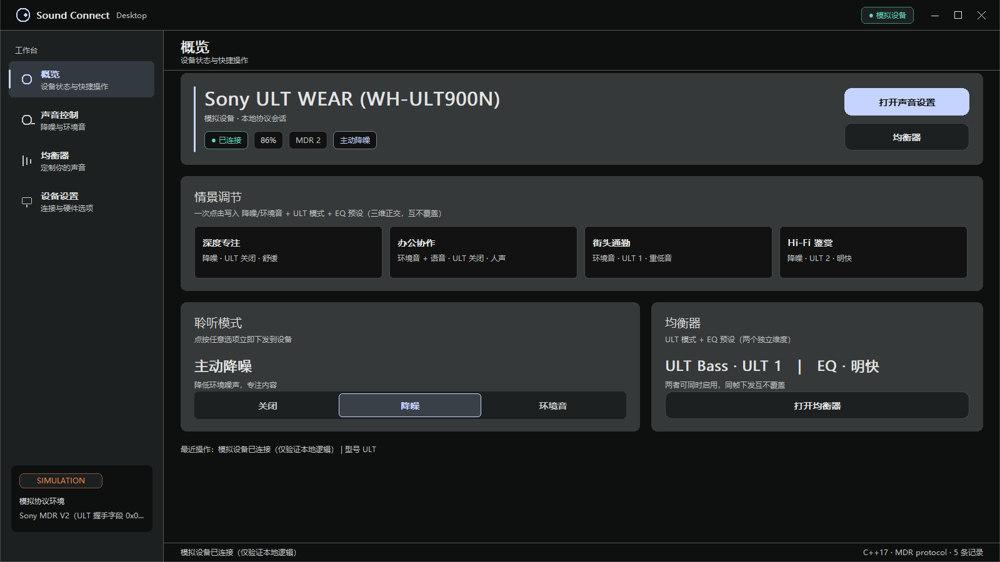
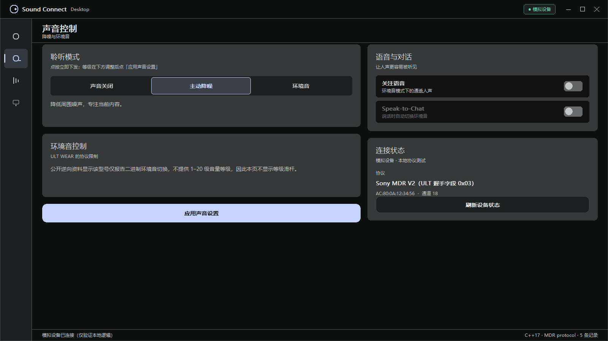
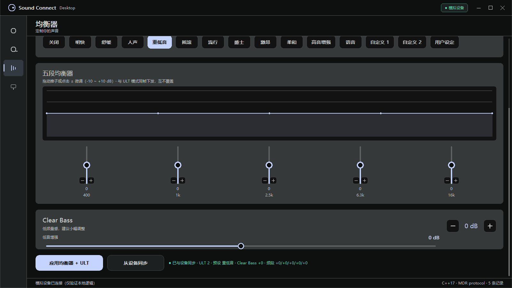
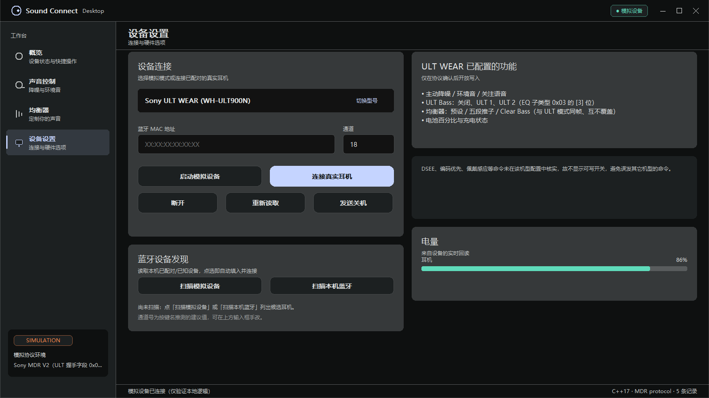

# Sony Sound Connect Desktop（非官方 · Windows 原生 GDI）

> 一个**零第三方依赖**的 Windows 桌面客户端，直连索尼蓝牙耳机的 MDR 协议（RFCOMM），
> 在**不登录、不联网**的前提下完成降噪 / 环境音、均衡器、ULT Bass、电量、设备连接等功能。

<p align="center">
  
</p>

---

## 目录

- [这是什么](#这是什么)
- [功能一览](#功能一览)
- [界面](#界面)
- [系统要求](#系统要求)
- [快速开始](#快速开始)
- [使用方式](#使用方式)
- [命令行参考](#命令行参考)
- [项目结构](#项目结构)
- [工作原理](#工作原理)
- [已知限制](#已知限制)
- [FAQ](#faq)
- [免责声明](#免责声明)

---

## 这是什么

Sony 官方的 Sound Connect 是 Android / iOS 应用，通过手机蓝牙控制耳机。
本项目把同样的能力搬到 **Windows 桌面**，实现方式是：

1. 用 Windows 原生蓝牙 API 枚举 / 连接耳机（RFCOMM 串口通道）；
2. 自己实现索尼 **MDR 协议**的报文编解码（`0x66/0x67/0x68`、`0x56/0x57/0x58/0x59` 等命令字）；
3. 用 Win32 + GDI 手绘一套**无边框、DPI 感知、多分辨率自适应**的深色界面。

**它不是什么：**

- ❌ 不是 Sony 官方产品，与索尼无任何关联；
- ❌ 不是音频驱动 / 不上报虚拟声卡，只做**控制信令**，音频仍由 Windows 蓝牙音频栈输出；
- ❌ 不会、也不需要连接索尼服务器。

---

## 功能一览

### ✅ 已实现（全部离线可用）

| 功能 | 说明 |
| --- | --- |
| **设备发现与配对** | 枚举本机蓝牙适配器与已配对/已知设备，显示名称、MAC、连接状态、是否音频设备；点选即可填入并连接 |
| **聆听模式切换** | 关闭 / 主动降噪 / 环境音，**点击立即下发**；失败自动回滚界面，不会出现“界面变了但耳机没变” |
| **关注语音（Voice Focus）** | 环境音模式下的语音增强开关 |
| **环境音等级** | 1–20 级滑杆（协议支持等级维度的机型） |
| **五段均衡器** | 400Hz / 1k / 2.5k / 6.3k / 16k 推子 + 实时曲线，−10 ~ +10 dB |
| **均衡器预设全表** | 关闭、重低音、明快、舒缓、人声、摇滚、流行、爵士、激昂、柔和、高音增强、语音、自定义 1、自定义 2、用户设定（15 项） |
| **Clear Bass** | 低音增强独立维度，±10 dB |
| **ULT Bass** | 仅 ULT WEAR（WH-ULT900N）：关闭 / ULT 1 / ULT 2，**与 EQ 正交，可同时生效** |
| **EQ 同步** | 从设备回读真实状态（`0x56` GET → `0x57` RET，并支持 `0x59` 主动通知） |
| **电量与充电** | 实时回读电量百分比 / 充电状态；真无线机型支持左耳 + 右耳 + 充电盒 |
| **情景调节** | 4 张一键卡（深度专注 / 办公协作 / 街头通勤 / Hi-Fi 鉴赏），一次点击写入“聆听模式 + ULT 模式 + EQ 预设”三个维度 |
| **本地设置持久化** | 下次启动自动恢复上次的机型、MAC、模式、EQ（`%LOCALAPPDATA%\SonySoundConnectUI\last-state.txt`） |
| **模拟器** | 内置有状态协议模拟器，**没有耳机也能跑通全部界面**并做回归测试 |

### 🚫 明确不做

固件更新下载、360 Reality Audio 云端配置、账号登录 / 云同步、语音提示语言包下载、
流媒体联动（Auto Play）、活动成就、诊断上报 —— 这些功能离开网络无法成立，
本项目定位就是“离线可用的本地 MDR 控制器”，**不伪造离线可用的假入口**。

> 完整的 38 条功能清单（含每条的资源依据与实现状态）见内部文档 `offline-feature-inventory.md`。

---

## 界面

| 概览 | 声音控制 |
| --- | --- |
|  |  |

| 均衡器 | 设备设置 |
| --- | --- |
|  |  |

界面设计依据从官方 Android 应用的资源包（`resources.arsc` + AXML）中逐值提取：
配色令牌（`#0E1010` surface、`#1C2021` surface_container、`#C5D4FF` primary、`#5FDBBA` tab indicator、
`#FF884B` / `#F47F95` / `#73D4FC` 等 multicolor）。原生 APK 中所有 `dimen` 值为 0，
间距与圆角因此按设计语言推导。详见 `XPACK-VS-IMPLEMENTATION.md`。

---

## 系统要求

| 项 | 要求 |
| --- | --- |
| 操作系统 | Windows 10 1809+ / Windows 11（用到 `BluetoothAuthenticateDeviceEx`、bthprops） |
| 编译器 | **MinGW-w64 g++**（C++17）或 MSVC 2019+；已验证 g++ 8.1.0 |
| 运行库依赖 | 无。单文件 exe，仅链接系统库 `ws2_32 / gdi32 / user32 / bthprops` |
| 蓝牙 | 需要可用且已开启的蓝牙适配器（耳机须先与 Windows 配对） |

---

## 快速开始

```bat
:: 1) 克隆仓库
git clone https://github.com/<your-name>/sony-soundconnect-desktop.git
cd sony-soundconnect-desktop

:: 2) 一键构建 + 回归测试
build_sony_ui.cmd
```

脚本会执行三步，全部成功才算通过：

```
[1/3] 编译协议仿真测试    → SonySoundConnectTest.exe
[2/3] 运行仿真回归测试    → 74 PASS / 0 FAIL
[3/3] 编译 Windows UI     → SonySoundConnectUI.exe
```

> 若 `g++` 不在 PATH，请编辑 `build_sony_ui.cmd` 顶部的 `GXX` 变量指向你的 MinGW 编译器。

手动编译（等价命令）：

```bat
g++ -std=c++17 -pthread -finput-charset=UTF-8 -fexec-charset=UTF-8 -O2 -Wall -Wextra ^
    sony-soundconnect-cross-fixed.cpp -o SonySoundConnectTest.exe -lbthprops

g++ -std=c++17 -pthread -DUNICODE -D_UNICODE -DENABLE_NATIVE_BT ^
    -finput-charset=UTF-8 -fexec-charset=UTF-8 -O2 -Wall -Wextra ^
    sony-soundconnect-ui.cpp -o SonySoundConnectUI.exe ^
    -mwindows -lws2_32 -lgdi32 -luser32 -lbthprops
```

---

## 使用方式

### 1. 先跑模拟器（不需要耳机）

```bat
SonySoundConnectTest.exe --sim --model ULT
```

界面窗口打开后会自动连接一台“虚拟 ULT WEAR”，所有开关、推子、情景卡都能操作并回读，
适合先熟悉界面或验证构建是否正常。

### 2. 连接真实耳机

1. 先在 **Windows 设置 → 蓝牙** 中把耳机配好；
2. 打开 `SonySoundConnectUI.exe`；
3. 进入「**设备设置**」页 →「选择机型」（ULT WEAR / WH-1000XM5 / WH-1000XM4 / WF-1000XM5）；
4. 点「**扫描本机蓝牙**」，在结果列表里点你的耳机 —— 名称、MAC、通道会自动填入；
5. 点「**连接真实耳机**」。

连接成功后，概览页会显示实时电量与当前模式，所有按钮改动都会**立即下发并回读**。

### 3. 手机/耳机不在身边时

模拟器与真实设备走的是**完全相同的协议代码路径**，仿真器还会模拟真机的行为细节
（例如设备对 SET 命令也会回一帧 `0x57`），所以模拟器里能跑通的流程，真机上逻辑是同一套。

---

## 命令行参考

`SonySoundConnectTest.exe`（控制台版，适合脚本与排查）：

| 参数 | 说明 |
| --- | --- |
| `--test-sim` / `--test` | 运行完整仿真回归测试（当前 **74 项**） |
| `--sim [--model ULT\|XM5\|XM4\|WF-XM5]` | 以交互模拟模式启动，不访问蓝牙硬件 |
| `--real <MAC> --channel <n> --model <code>` | 连接真实耳机；必须显式指定通道与机型 |
| `--scan` | 列出模拟设备（不访问硬件，用于自测） |
| `--scan-real` | 枚举本机真实蓝牙适配器与已配对设备 |
| `--help` | 显示帮助 |

```bat
:: 示例：扫描本机蓝牙耳机
SonySoundConnectTest.exe --scan-real

:: 示例：直连 ULT WEAR
SonySoundConnectTest.exe --real A8:E6:E8:67:19:B5 --channel 18 --model ULT
```

`SonySoundConnectUI.exe`（GUI 版）只接受 `--test-sim`（静默跑一遍回归后退出）。

### 支持的机型

| 机型代码 | 设备 | MDR 代次 | 默认 RFCOMM 通道 | ULT Bass |
| --- | --- | --- | --- | --- |
| `ULT` | Sony ULT WEAR (WH-ULT900N) | V2 | 18 | ✅ |
| `XM5` | Sony WH-1000XM5 | V2 | 1 | — |
| `XM4` | Sony WH-1000XM4 | V1 | 1 | — |
| `WF-XM5` | Sony WF-1000XM5（真无线） | V2 | 2 | — |

> ⚠️ **RFCOMM 通道是按机型推测的建议值，不是 SDP 协商结果**。如果连接失败（常见 `10064` / `10061`），
> 请在设备页手动改通道号再试。这是本项目当前最大的待改进项之一。

---

## 项目结构

```
.
├─ sony-soundconnect-ui.cpp          # Win32 + GDI 界面（窗口 / 绘制 / 交互 / 状态机）
├─ sony-soundconnect-cross-fixed.cpp # 协议后端（MDR 编解码 / RFCOMM / 蓝牙发现 / 模拟器 / 自检）
├─ build_sony_ui.cmd                 # 一键构建 + 回归
├─ .vscode/tasks.json                # VS Code 构建任务
├─ CHANGES.md                        # 逐轮变更记录（含每条改动的证据与不确定性）
├─ XPACK-VS-IMPLEMENTATION.md        # 「官方 App 资源规范 vs 本实现」差异清单
└─ shot\                             # 多分辨率 / 多页面截图取证（含可复现脚本）
```

`sony-soundconnect-ui.cpp` 通过 `#include "sony-soundconnect-cross-fixed.cpp"` 复用后端，
因此**界面与协议是同一个编译单元**，改后端不需要额外链接步骤。

---

## 工作原理

```
┌──────────────┐   Win32 消息   ┌───────────────────┐   RFCOMM (Socket)   ┌────────────┐
│  GDI 界面层   │ ─────────────► │  HeadphoneController │ ─── MDR 报文 ───► │ 索尼耳机    │
│ (ui.cpp)     │ ◄───────────── │  (协议编解码 + 状态) │ ◄── 0x67/0x57 ── │  (真机)     │
└──────────────┘   回读状态      └───────────────────┘                    └────────────┘
                                        │
                                        └──► StatefulMdrSimulator（仿真器，同一接口）
```

几个值得说明的设计决定：

- **所有阻塞操作都在工作线程**，界面线程只做绘制与消息处理，不卡 UI；
- **写入后必回读**：每次 SET 之后都会等设备回包再刷新界面，避免“界面显示成功、耳机没变”；
- **回读不串台**：真机对 SET 命令也会回一帧参数，若不清空缓冲，紧接着的 GET 会读到上一条旧回包
  （即“慢一拍”）。本项目在发命令前统一排空缓冲帧，并让 SET 直接以参数回包作为应答；
- **ULT 与 EQ 正交**：ULT WEAR 的两个维度共用同一条帧，但分别落在不同字节位，因此可以同时生效、
  互不覆盖（有专门的回归测试守护这一点）；
- **解析必须严格**：任何长度、取值范围不合规的回包一律拒绝并保留旧状态，绝不污染界面。

---

## 已知限制

1. **RFCOMM 通道为推测值**，未做 SDP 服务发现。连接失败时请手动指定通道。
2. **真机验证有限**：自动化测试（74 项）全部基于仿真器；真机行为已在 ULT WEAR 上人工验证过
   主要路径，其他机型与固件版本可能存在差异。
3. **ULT WEAR 的部分命令字**（DSEE、编解码优先级、佩戴感应）没有经过实机确认，
   因此在该机型上**主动禁用**，而不是借用其它机型的报文。
4. **AVRCP 功能**（播放控制、音量）不属于 MDR 协议，本项目不接管。
5. 情景卡的三个维度**逐步骤下发**，中途失败不会回滚已成功的步骤（界面会如实显示失败）。

---

## FAQ

**Q：为什么界面没有边框？关不掉？**
窗口是无边框自绘的（`WS_POPUP` + `WS_THICKFRAME`），标题栏区域可拖动，四边可拉伸，
右上角有关闭按钮。最小尺寸为 680×400（DPI 感知）。

**Q：界面文字乱码？**
请确认用 `-finput-charset=UTF-8 -fexec-charset=UTF-8` 编译（`build_sony_ui.cmd` 已包含）。

**Q：连接报 `10064` / `10050` / `10061`？**
`10064` = 主机不可达（耳机未开机 / 距离太远 / 通道不对）；`10050` = 适配器不可用（蓝牙被关闭或被占用）；
`10061` = 对方拒绝连接（通道错误）。先确认耳机开机、Windows 里处于“已连接/已配对”，再换通道试。

**Q：会不会自动连接、自动改我的耳机设置？**
不会。除了本程序内的操作，它不会在后台改任何设备状态；模拟器里的操作也不会写入真机。

**Q：设置保存在哪？怎么重置？**
`%LOCALAPPDATA%\SonySoundConnectUI\last-state.txt`，删掉即恢复默认。

---

## 免责声明

本项目为个人学习与自用的**非官方**工具，与 Sony 公司无任何关联，未获其授权或背书。
协议报文来源于公开的第三方逆向资料与自有实机抓包；"SONY"、"WH-ULT900N"、"Sound Connect"
等名称与标识归其各自权利人所有。

使用本软件可能对设备造成不可预期影响，请**自行承担风险**。请勿用于商业用途。
